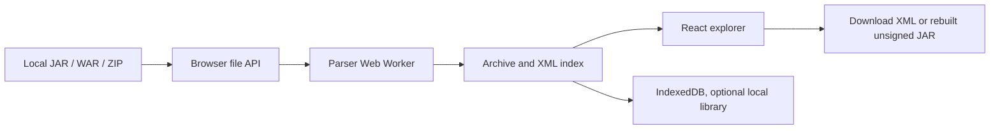

# IRIS Explorer

IRIS Explorer is a privacy-first, browser-only workbench for inspecting JAR, WAR, and ZIP archives that contain Apache Camel and Spring XML. Open an archive locally to discover embedded JARs, Camel services, REST endpoints, route details, and source XML—without uploading the archive to a server.

## Try it online

Use IRIS Explorer directly in your browser: [mushtaqalvi.github.io/IRIS_Container_Explorer](https://mushtaqalvi.github.io/IRIS_Container_Explorer)

## Analyze APIs without deploying

IRIS Explorer helps developers statically inspect existing API and integration functionality before deployment. Open an application archive to find REST endpoints, Camel routes, service configuration, and source XML locally—without starting JBoss or another application server. It analyzes the archive; it does not run application code.

## Highlights

- Opens local `.jar`, `.war`, and `.zip` files through the browser file picker or drag and drop.
- Recursively indexes embedded archives and XML files, including Apache Camel Spring routes.
- Finds services, REST endpoints, parameters, consumer routes, route targets, and bean references.
- Searches across locally saved archive indexes by archive name or REST URL.
- Displays and downloads service XML.
- Offers a local Camel route visualizer when a compatible Camel 4 catalog is selected.
- Stores optional analysis and JAR payloads only in the browser's IndexedDB; nothing is sent to an application server.
- Blocks unsafe archive paths and prevents rebuilding signed JARs.

## Privacy and data handling

IRIS Explorer has no backend and does not make application network requests. Archive bytes are read from a file selected by you, processed in a browser Web Worker, and stay in the browser. If you keep an archive in the local library, its index and eligible JAR payloads are stored in that browser profile's IndexedDB.

Use the browser's site-data controls to remove locally stored archives. Treat the browser profile as sensitive if it contains proprietary archives.

## Architecture



The React UI runs entirely in the browser. Parsing, XML classification, archive safety checks, and optional JAR rebuilding run locally; the parser executes in a dedicated Web Worker so large scans do not block the UI. The Kaoto Camel catalog is copied into the static build and is loaded from the same GitHub Pages origin.

## Use

1. Open the deployed site or start the app locally.
2. Drop a `.jar`, `.war`, or `.zip` archive onto the welcome screen, or select one with **Open archive**.
3. Choose an embedded JAR, then a service, to inspect its REST endpoints, parameters, routes, and source XML.
4. Use the top search field for JAR names or REST paths, for example `path:/customers`.
5. Open a service XML file to download it, or use the local workbench to edit compatible XML and download a rebuilt unsigned JAR.

Signed JARs are intentionally not rebuilt because modifying them would invalidate their signatures.

## Local development

Prerequisites: Node.js 20 or newer and npm.

```bash
npm ci
npm run dev
```

Open the local URL printed by Vite. Run the checks before opening a pull request:

```bash
npm test
npm run build
```

The production output is written to `dist/` and can be previewed locally:

```bash
npm run preview
```

`package.json` remains `private: true` deliberately: this project is open source on GitHub but is not intended to be published to npm.

## Project layout

```text
src/
  core/       parsing contracts, archive safety, search, export, and workers
  features/   explorer and XML workbench UI
  storage/    IndexedDB repository
  workers/    off-main-thread archive parser and JAR packager
```

## Contributing and security

Please read [CONTRIBUTING.md](CONTRIBUTING.md) before submitting changes. Security issues should follow [SECURITY.md](SECURITY.md) rather than being disclosed in a public issue.

## License

This project is licensed under the [MIT License](LICENSE).
